<div align="center">

# Arduino Mega AR

**Telefon kamerasını bir Arduino Mega 2560'a tutun. Kart tanınır ve üstüne yaşayan bir dijital ikiz oturur.**

Atatürk Üniversitesi · Artırılmış Gerçeklik Uygulama Geliştirme · 5. hafta, **Grup 6 (G6): Nesne Takibi**


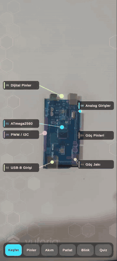&nbsp;&nbsp;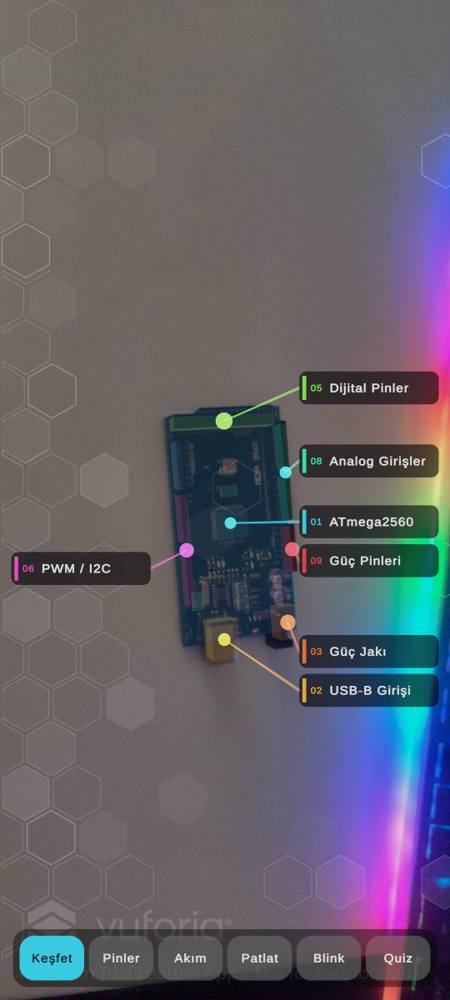

*Gerçek kart, Redmi Note 12 Pro. Solda 2 kat hızlandırılmış demo, sağda etiketler.*
**[▶ Tam demo videosu (30 sn)](Docs/demo.mp4)**

</div>

---

## Ne yapıyor?

İzlencedeki görev: *"Bir nesnenin parçalarını etiketleyen uygulama."* Biz bunu bir elektronik kartın canlı ders kitabına dönüştürdük.

| | Özellik | Açıklama |
|---|---|---|
| 🎯 | **Silüetsiz tanıma** | Ekranda yazı ya da hizalama silüeti yok. Kamera kartı gördüğü anda hologram oturur. |
| 🏷️ | **Akıllı etiketler** | Başta yalnızca 7 ana bölge etiketlenir. Kalan 8 parça, dokununca açılır. Ekran asla kalabalıklaşmaz. |
| 📍 | **Pin haritası** | 92 pinin her birinin adı (D22–D53, A0–A15, TX/RX, SDA/SCL, 5V, GND…) gerçek pinin üstünde, işlevine göre renkli. |
| ⚡ | **Akım animasyonu** | USB'den ve adaptörden gelen akım; sigorta, regülatör ve işlemci üzerinden pinlere ışık izleriyle akar. |
| 💡 | **Sanal Blink** | 13 ve GND pinlerine sanal bir LED takılır, kod satır satır çalışır, kart üzerindeki L LED'i de onunla yanar. |
| 💥 | **Patlat** | Bileşenler karttan havaya kalkar; katmanlı yapı görünür. |
| 🧠 | **Quiz** | "Dijital pinler nerede? Dokun!" Doğru cevapta konfeti ve ses. |

Sesler koddan üretilir. Kartın 3B modeli de koddan üretilir: bileşen konumları Arduino'nun resmî PCB dosyasından (`Arduino_MEGA_2560-Rev3.brd`) alınmıştır. Projede dışarıdan alınmış model, ses ya da görsel yoktur.

## Ekranlar

<table>
<tr>
<td align="center">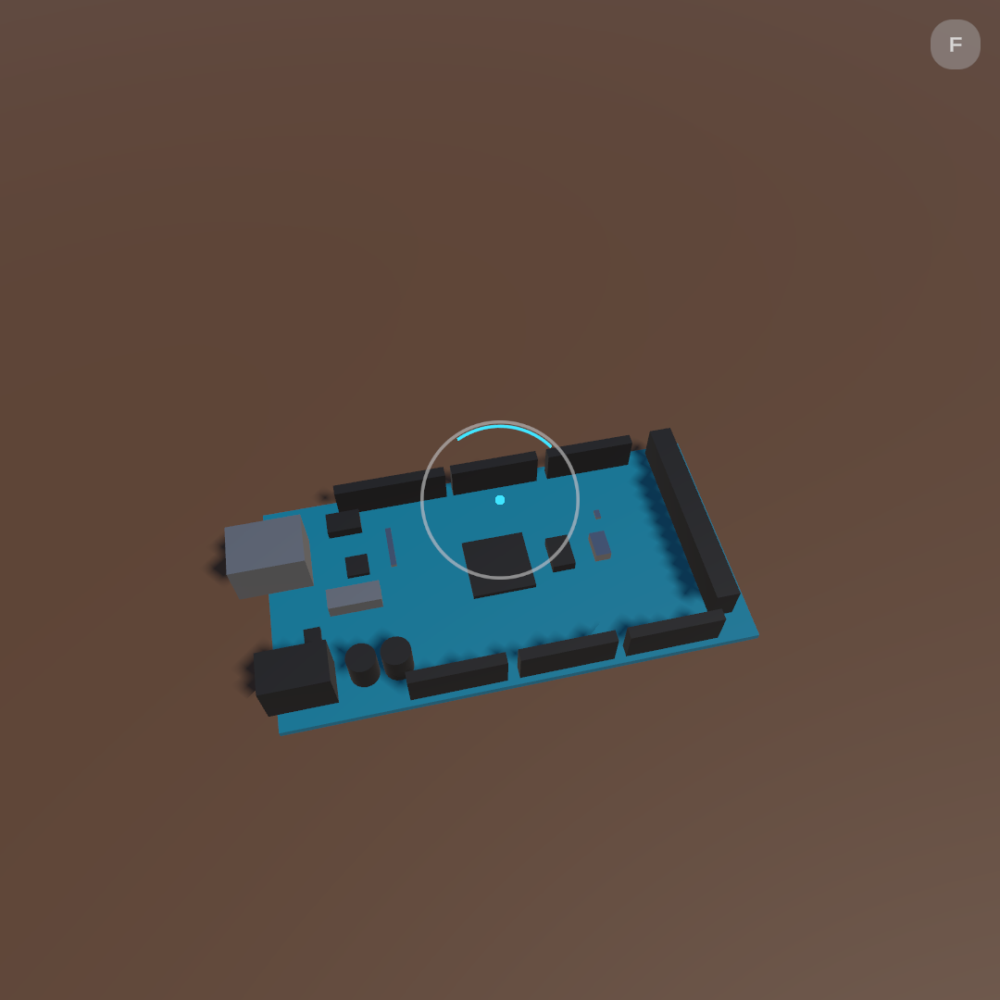<br><sub>Aranıyor: yalnızca tarama halkası</sub></td>
<td align="center">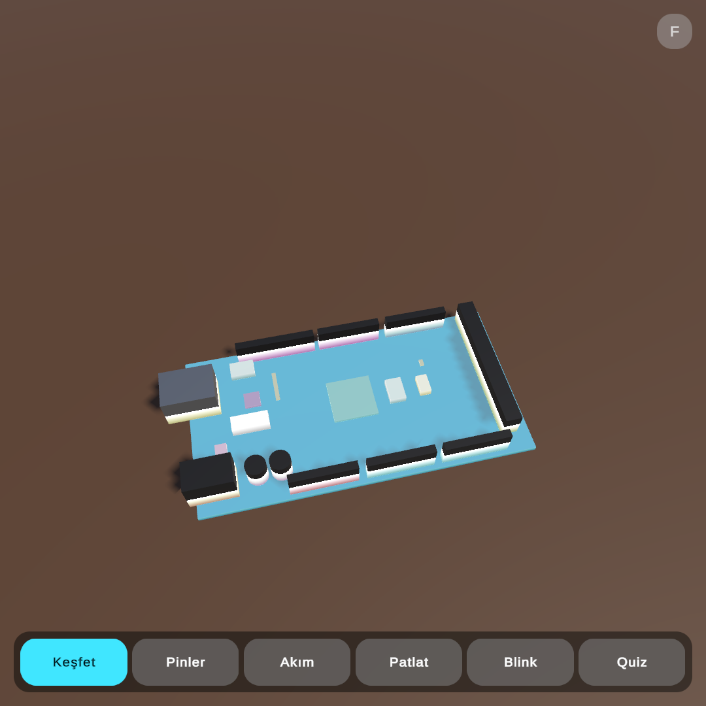<br><sub>Bulundu: hologram taranarak belirir</sub></td>
<td align="center">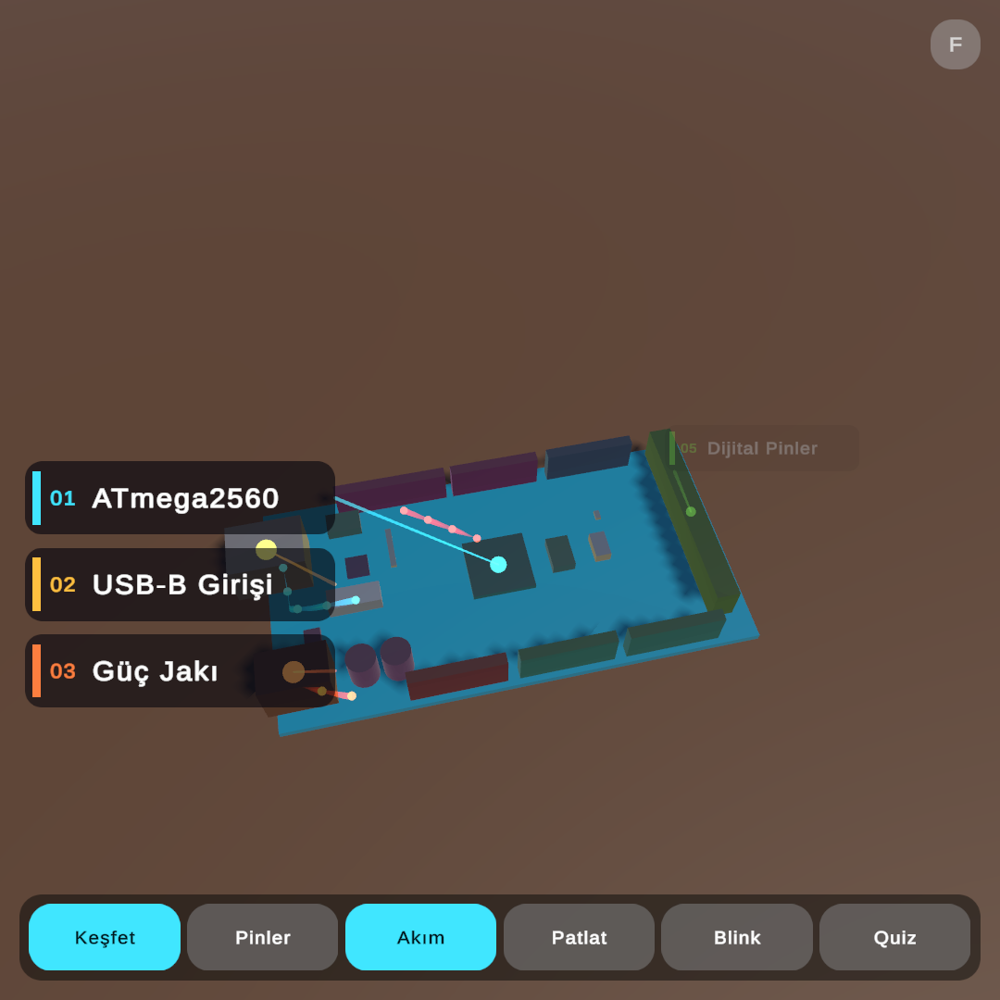<br><sub>Akım animasyonu</sub></td>
</tr>
<tr>
<td align="center">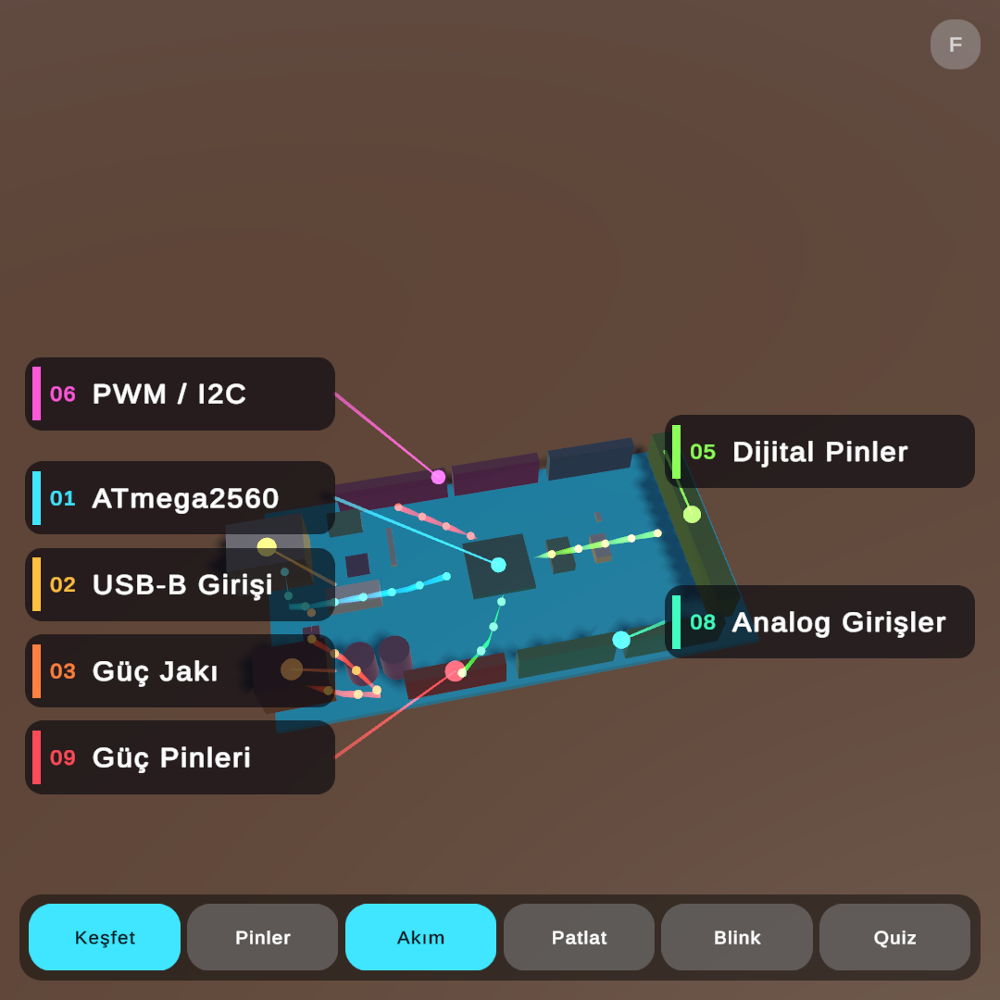<br><sub>Ana bölge etiketleri</sub></td>
<td align="center">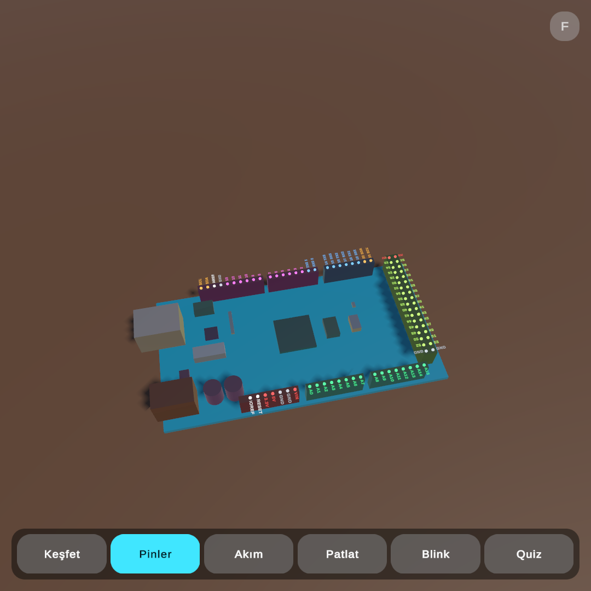<br><sub>92 pinlik harita</sub></td>
<td align="center">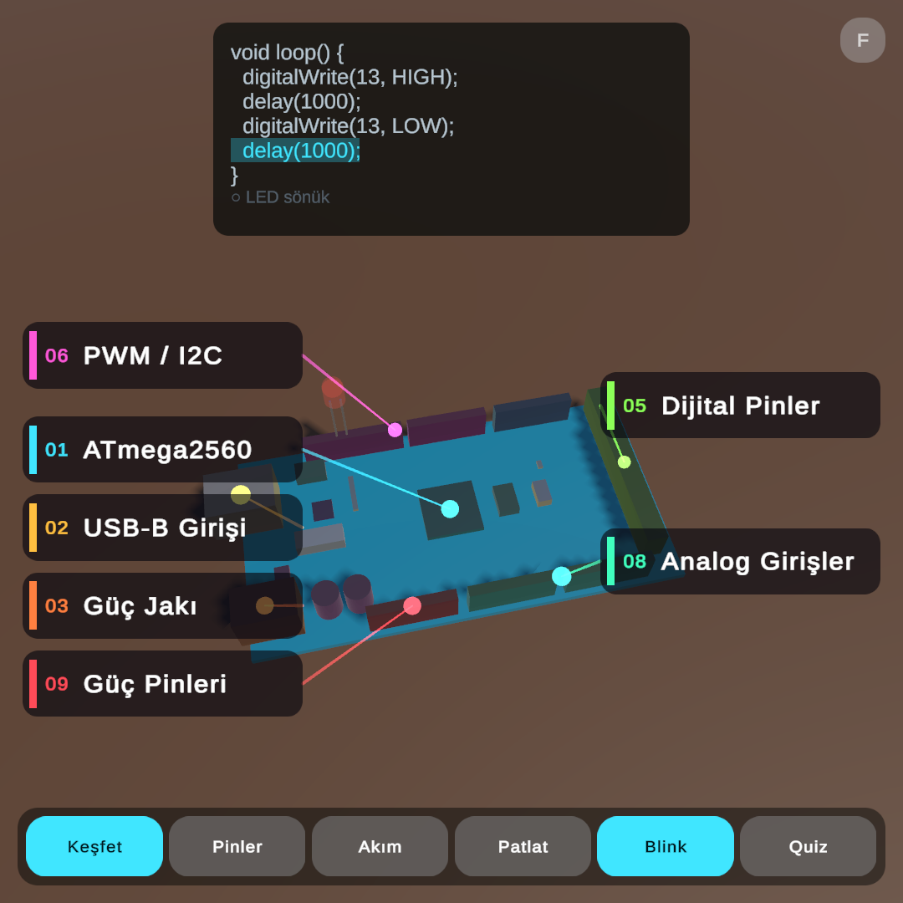<br><sub>Sanal Blink ve canlı kod</sub></td>
</tr>
<tr>
<td align="center">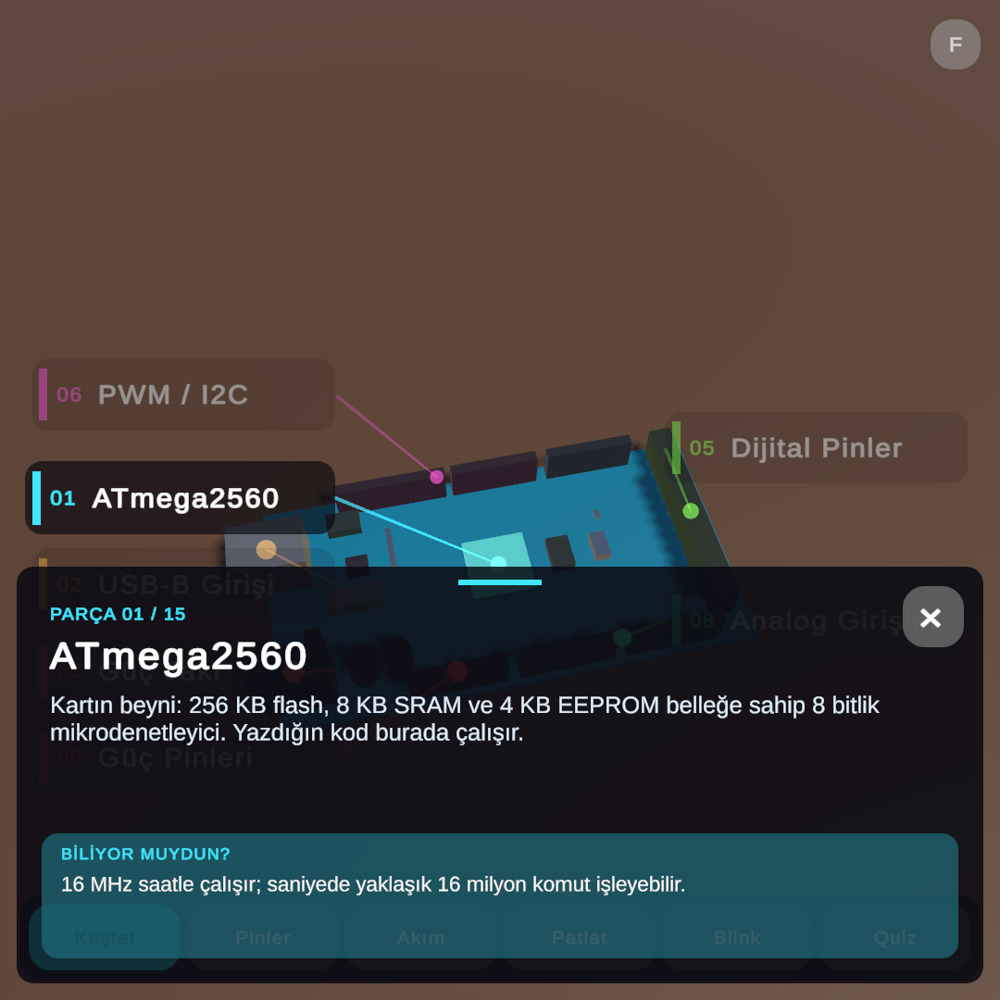<br><sub>Bilgi kartı</sub></td>
<td align="center">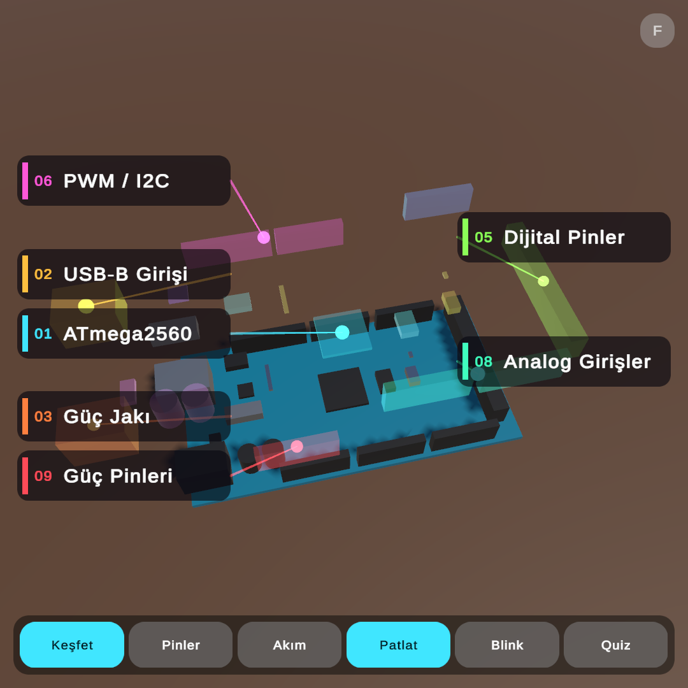<br><sub>Patlatılmış görünüm</sub></td>
<td align="center">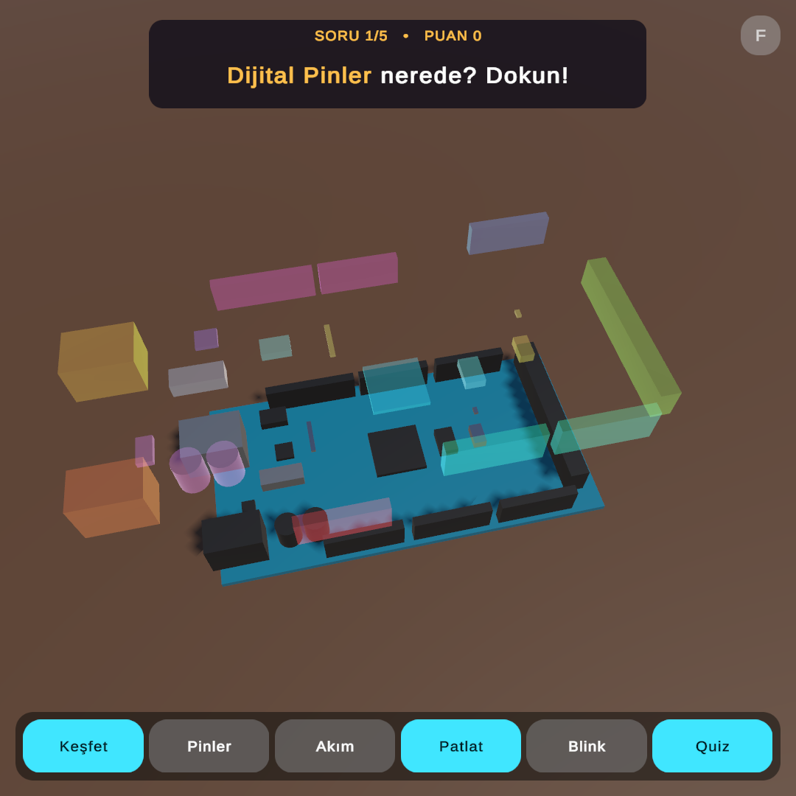<br><sub>Quiz</sub></td>
</tr>
</table>

İlk görsel dışındakiler Windows simülasyon derlemesinden otomatik alınmıştır (`-g6shots`).

## Nasıl tanıyor?

Uygulama iki Vuforia hedefini **aynı anda** çalıştırır. Hangisi önce bulursa hologram ona oturur:

```
              ┌─────────────────────────────┐
  Kamera ───▶ │ Image Target  (üstten foto) │──┐
              └─────────────────────────────┘  │   VuforiaTrackingSource
              ┌─────────────────────────────┐  ├──▶ en iyi pozu seçer ──▶ Dijital ikiz
  Kamera ───▶ │ Model Target  (3B model)    │──┘   (TRACKED > EXTENDED)
              └─────────────────────────────┘
```

1. **Image Target:** Kartın üstten çekilmiş fotoğrafı. OpenCV ile kart kenarlarından kırpılıp düzeltildi ve 101,6 × 53,34 mm ölçüsüne oturtuldu. Kart neredeyse her açıdan anında tanınır.

   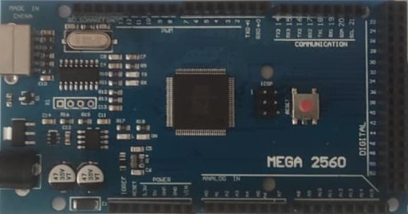

2. **Model Target:** Kodla üretilen 3B model, Vuforia Model Target CLI ile veritabanına dönüştürüldü. Beş kılavuz açısı (üstten, USB tarafı, pin tarafı, arka, çapraz) ekranda silüet **göstermeden** arka planda üçer saniyede bir sırayla denenir.

Hedefler çalışma anında koddan oluşturulur (`ObserverFactory.CreateModelTarget` / `CreateImageTarget`). Sahnede elle yerleştirilmiş Vuforia nesnesi yoktur.

## Kurulum

### Gereksinimler

| Araç | Sürüm |
|---|---|
| Unity | 6000.3.27f1 (Unity 6.3 LTS) + Android Build Support |
| Vuforia Engine | 11.4.4 (depoda yok, aşağıya bakın) |
| Test cihazı | Android 10+ (API 29), ARM64 |

### Adımlar

1. Depoyu klonlayın.
2. Vuforia Engine 11.4.4 paketini [developer.vuforia.com](https://developer.vuforia.com/downloads/sdk) adresinden indirin. `com.ptc.vuforia.engine-11.4.4.tgz` dosyasını `Packages/` klasörüne koyun. (Paket 138 MB olduğu ve PTC lisansına tabi olduğu için depoda yoktur.)
3. Projeyi Unity Hub ile açın.
4. Vuforia lisans anahtarınızı girin: **Window › Vuforia Configuration › App License Key**. Anahtar `Assets/Resources/VuforiaConfiguration.asset` dosyasında saklanır ve `.gitignore` ile depodan dışlanır.
5. **G6 › Derle › Android APK** ya da `File › Build Profiles › Android › Build And Run`.

### Kart olmadan denemek

`Assets/G6/Scenes/G6_NesneTakibi.unity` sahnesini açıp **Play**'e basın. Simülasyon iki saniye sonra kartı "bulur".

| Kontrol | İşlev |
|---|---|
| Fareyle sürükle | Kamera kartın etrafında döner |
| Tekerlek | Yakınlaş / uzaklaş |
| `F` | Takibi kaybettir / geri getir |

Sahne bozulursa **G6 › Sahneyi Kur** menüsü onu sıfırdan kurar.

## Proje yapısı

```
Assets/G6/
  Runtime/                     Uygulama (Vuforia'dan bağımsız)
    AppController.cs           Durum akışı, araç çubuğu, quiz, efektler
    AppUI.cs                   Koddan kurulan arayüz: tarama halkası, araç çubuğu, bilgi kartı, kod paneli
    DigitalTwin.cs             Hologram ikiz: tarama, patlatma, seçim
    LabelManager.cs            Çakışmasız iki sütunlu etiket yerleşimi
    PinMap.cs                  92 pinin düz yazı etiketleri
    EnergyFlow.cs              Akım izleri (TrailRenderer)
    BlinkDemo.cs               Sanal LED + canlı kod vurgusu
    TrackingSource.cs          Takip soyutlaması (bulundu / kayboldu)
    SimulatedTrackingSource.cs Editörde kartsız deneme
  Vuforia/                     Yalnızca Vuforia paketi varken derlenir (VUFORIA_PRESENT)
    VuforiaModelTargetLoader.cs  Hedefleri çalışma anında oluşturur
    VuforiaTrackingSource.cs     Birden fazla hedefi tek pozda birleştirir
  Editor/
    ArduinoMegaModel.cs        15 parça: .brd dosyasından ölçüler, açıklamalar
    ArduinoMegaPins.cs         Pin adları, renkleri, konumları; akım yolları
    SceneBuilder.cs            Sahneyi ve ikizi koddan kurar
    ObjExporter.cs             Modeli DAE/OBJ'ye ve Model Target JSON'una yazar
  Shaders/                     Hologram (Fresnel + tarama), Glow
Tools/ModelTargetUret.ps1      Model Target CLI ile veritabanı üretimi
Docs/                          Uygulama föyü, istem günlüğü, ekran görüntüleri
```

**Mimari:** `AppController` Vuforia'yı tanımaz; yalnızca `TrackingSource.TrackingChanged` olayını dinler. Böylece proje Vuforia olmadan da derlenir ve sınıfta cihazsız gösterilebilir.

## Belgeler

- [Uygulama föyü](Docs/Uygulama_Foyu.md): 40 dakikalık ders akışı, anlatım notları, adım adım canlı uygulama
- [İstem günlüğü](Docs/Istem_Gunlugu.md): kullanılan istemler, karşılaşılan hatalar ve düzeltmeleri

## Bilinen sınırlar

- Ücretsiz Vuforia lisansıyla Model Target, ekranda **"Premium Trial Feature App – Not for Distribution"** filigranı gösterir. Dağıtım için ücretli lisans gerekir.
- Image Target fotoğrafı bizim kartımızdan çekildi. Farklı bir klon kartta baskılar ve bileşen yerleri değişebilir. Bu durumda kendi kartınızın fotoğrafını `Assets/StreamingAssets/Vuforia/arduino_ust.jpg` olarak koyun.
- Parlak, simetrik ya da çok düz nesneler Model Target için zordur. Ayrıntı: föy, "Takibe uygun nesne seçimi".

## Ekip

**Grup 6 (G6)**: Atatürk Üniversitesi, Artırılmış Gerçeklik Uygulama Geliştirme dersi.

## Lisanslar

- Kod ve içerik: G6 ekibi (ders projesi).
- Bileşen konumları: Arduino Mega 2560 Rev3 referans tasarımı, [CC BY-SA](https://www.arduino.cc/en/hardware).
- TextMeshPro (LiberationSans): SIL Open Font License 1.1.
- Vuforia Engine: PTC lisans koşullarına tabidir. Ayrıntı: https://developer.vuforia.com/pricing
